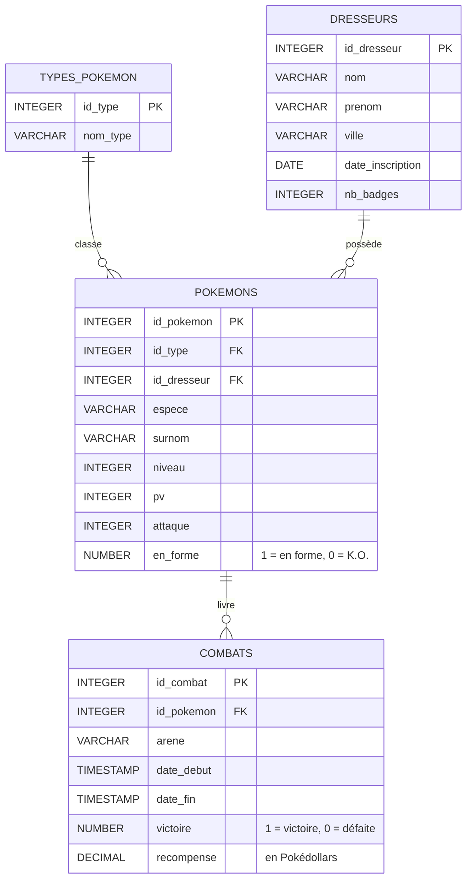

# TP SQL — Les combats d'arène Pokémon

TP d'entraînement au SQL pour étudiants de 1ère année (BUT Informatique), sous Oracle.

La base de données enregistre des **dresseurs**, leurs **Pokémon** et les **combats** que ces Pokémon livrent dans les arènes de Kanto. Chaque combat gagné rapporte une récompense en Pokédollars (0 en cas de défaite).

Le TP fait réviser, sur une seule fiche, toutes les notions vues en cours : sélection, filtres, tri, fonctions d'agrégation, jointures, `GROUP BY` et `HAVING`.

## Contenu du dépôt

| Fichier | Description |
|---|---|
| `create_pokemon.sql` | Script de création de la base (tables + données), à exécuter en premier |
| `Fiche_Pokemon_Combats.docx` | Fiche de TP : 47 exercices sur 5 niveaux |
| `corrige_pokemon.sql` | Corrigé complet, avec le résultat attendu sous chaque requête |
| `README.md` | Ce fichier |

## Modèle de données

### Les données

- **5 dresseurs** : Sacha, Ondine, Pierre, Régis et Jessie (de la Team Rocket, qui perd tous ses combats).
- **8 types** : Feu, Eau, Plante, Électrik, Roche, Normal, Poison et Spectre. Le type Spectre n'a aucun Pokémon.
- **13 Pokémon** : Pikachu, Dracaufeu, Léviator, Ronflex, Magicarpe… Deux d'entre eux n'ont jamais combattu.
- **48 combats** entre septembre et octobre 2026, dans 4 arènes : Argenta, Azuria, Carmin-sur-Mer et Céladopole.

Les données sont construites pour qu'aucun exercice ne renvoie un résultat vide, sauf la question 21, qui dépend de la date du jour.

## Les exercices

| Niveau | Thème | Questions | Notions |
|---|---|---|---|
| 1 | Requêtes simples | 1 à 10 | `SELECT`, `WHERE`, `LIKE`, `BETWEEN` |
| 2 | Tri, filtres et fonctions simples | 11 à 21 | `ORDER BY`, `FETCH FIRST`, `COUNT`, `SUM`, `AVG`, `MIN`, `MAX`, `INTERVAL`, `SYSDATE` |
| 3 | Jointures | 22 à 31 | `JOIN` sur 2 et 3 tables, `NOT IN`, `DISTINCT`, sous-requête avec `MAX` |
| 4 | Agrégations et regroupements | 32 à 39 | `GROUP BY`, regroupement par mois, durée moyenne |
| 5 | Utilisation du `HAVING` | 40 à 47 | `HAVING`, `COUNT(DISTINCT …)`, sous-requête dans le `HAVING` |

En fin de fiche, un prompt à coller dans une IA permet aux étudiants qui ont terminé d'obtenir des exercices supplémentaires sur la même base, sans sortir des notions déjà vues.

## Utilisation

1. Ouvrir `create_pokemon.sql` et l'exécuter dans l'éditeur de requêtes Oracle (SQL Developer, Oracle Live SQL…).
2. Distribuer `Fiche_Pokemon_Combats.docx` aux étudiants.
3. Garder `corrige_pokemon.sql` pour la correction : chaque requête est suivie d'un commentaire `-- Résultat attendu : …` pour comparer rapidement.

> Le script commence par des `DROP TABLE` : à la première exécution, Oracle signale que les tables n'existent pas encore. Ces erreurs peuvent être ignorées.

## Compatibilité

Le script et le corrigé sont écrits en syntaxe **Oracle** (`NUMBER`, `TO_DATE`, `SYSDATE`, `TRUNC`, `INTERVAL`, `FETCH FIRST n ROWS ONLY`, qui demande Oracle 12c ou plus récent).

## Auteur

Fabien CASTELLA — BUT Informatique, IUT de Rodez.

*Pokémon et les noms des personnages sont des marques de Nintendo, Creatures Inc. et GAME FREAK inc. Ce TP est un support pédagogique non commercial, sans lien avec ces sociétés.*